<div align="center">


# Zacks Court

**把每一次上场，留下来。**

一台 iPhone 架在场边录网球，在手机本机实时估计每一拍的球速、落点和动作；<br/>另一台 iPhone、Mac 或任何浏览器在场外实时看。不用账号，不上云，数据只在你自己的设备上。

*Courtside tennis recording with on-device, per-shot estimates of speed, bounce and stroke — for iPhone and Mac.*


[亮点](#亮点) · [使用场景](#使用场景) · [界面](#界面) · [工作原理](#工作原理) · [效果对比](#效果对比) · [路线图](#路线图) · [快速开始](#快速开始) · [参与开发](#参与开发)

</div>

<p align="center">
  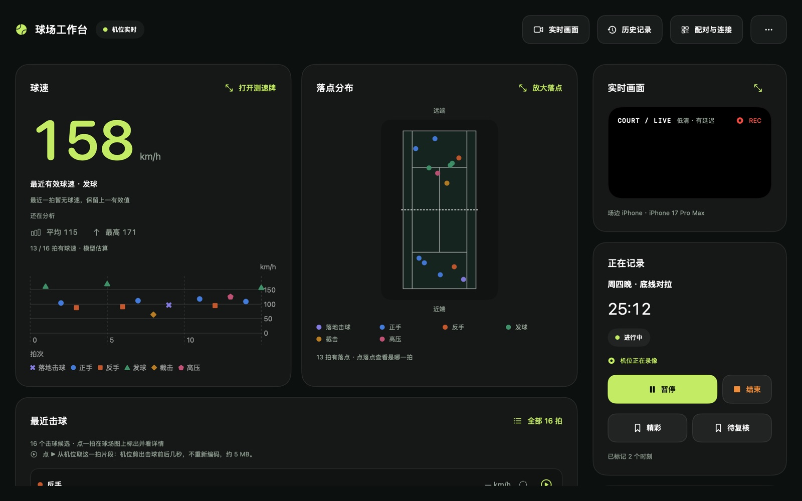
  <br/><sub>Mac 看板记录中的界面。数据是虚构示例。</sub>
</p>

---

## 亮点

| | |
| --- | --- |
| 🎾 **逐拍结果** | 每一拍给出击球时刻、动作（正手、反手、发球、截击、高压）、球速估计、落点和界内外估计。 |
| ⚑ **挑战** | 对刚才那球有异议时，在任何一块屏幕（大屏看板、浏览器、机位手机）点「挑战」，机位重新判这一拍，所有屏幕一起播放界内外回放并报 Out! 或 In.（男声或女声可选，AI 合成），结果存进记录。 |
| 📱 **分析就在场边手机上** | 机位以 1920×1080 / 60 帧录像，同时在本机实时分析。网络只传逐拍数据，Wi-Fi 不稳不影响分析和录像。 |
| 🧭 **自动识别球场** | 从画面里的白线求出相机和球场，全程自动，没有手动标定。 |
| 🖥️ **三种看板** | 另一台 iPhone 或 Mac（TLS 加密），或者任何设备的浏览器（扫码即用，不用装 App）。 |
| 🏁 **场边测速牌** | 全屏大字显示最近一拍或发球的球速，附最高、平均和趋势。 |
| 🔒 **不用账号，不上云** | 没有服务器、统计或广告。录像和结果只存在你的设备上。 |
| ✋ **不知道就写「—」** | 证据不够时不给数，写明原因，统计里不按 0 算。球速和落点都叫「估计」，不叫「测量」。 |
| 🎬 **导入视频也能分析** | 不在球场时，从相册或「文件」选一段 60 帧/秒的横屏网球视频，用机位同一套模型逐拍分析，存进历史记录。 |
| 🧪 **自研分析链** | 球检测用 MIT 许可的 TrackNetV3，击球、触地、测速、动作和球场识别都是本项目自己的 Swift 代码。上架版只用自研模型。 |

## 使用场景

### 场景一：一台 iPhone，自己练

手机横放在底线后方的支架上，打完在手机上回看。

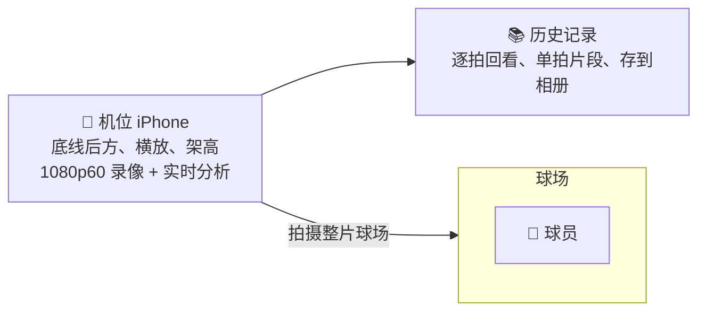

### 场景二：机位 + App 看板（教练或队友在场外看）

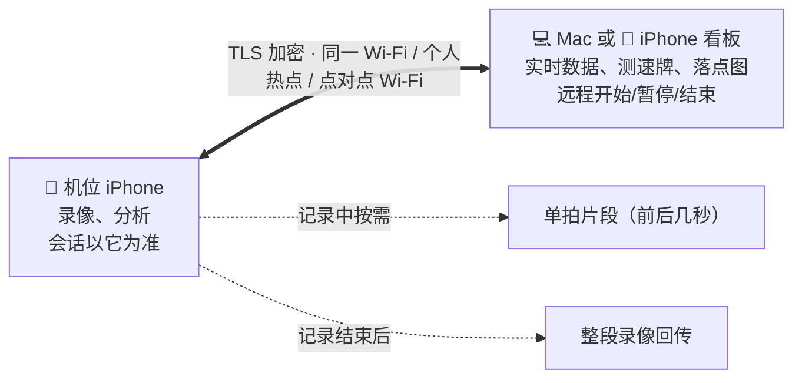

断线时机位照常录像和分析，重连后自动补齐数据。看板上的操作是请求，以机位为准。

### 场景三：机位 + 浏览器看板（安卓、平板、电脑）

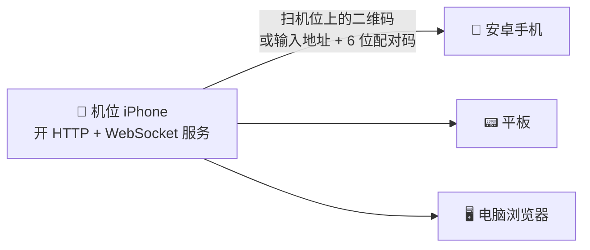

浏览器看板走局域网明文 HTTP，同一网络里能抓包的人可以看到逐拍数据和预览画面，见[数据与隐私](#数据与隐私)。

### 机位怎么架

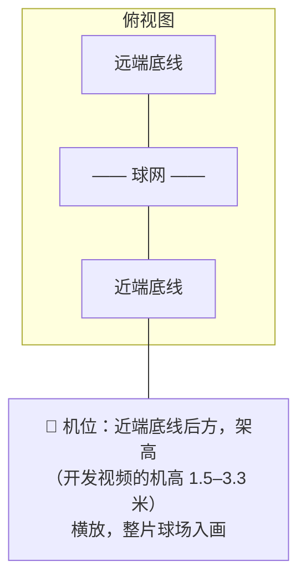

画面里要能看到两条底线、边线、发球线和球网。机位越高，远端越清楚。

## 界面

<table>
  <tr>
    <td width="33%">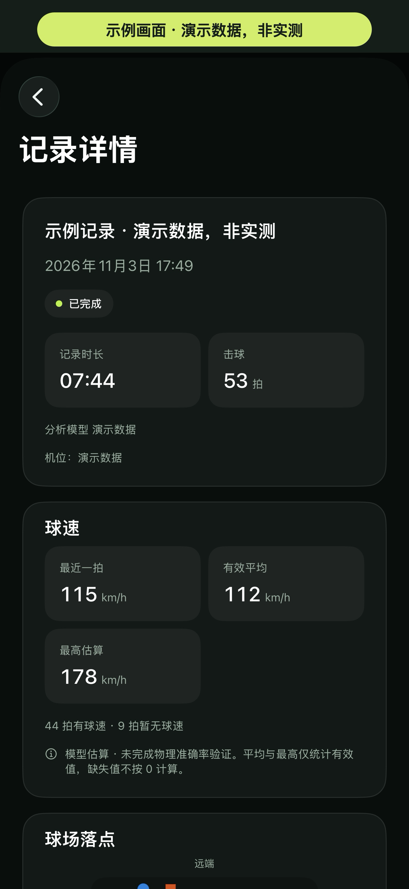</td>
    <td width="33%">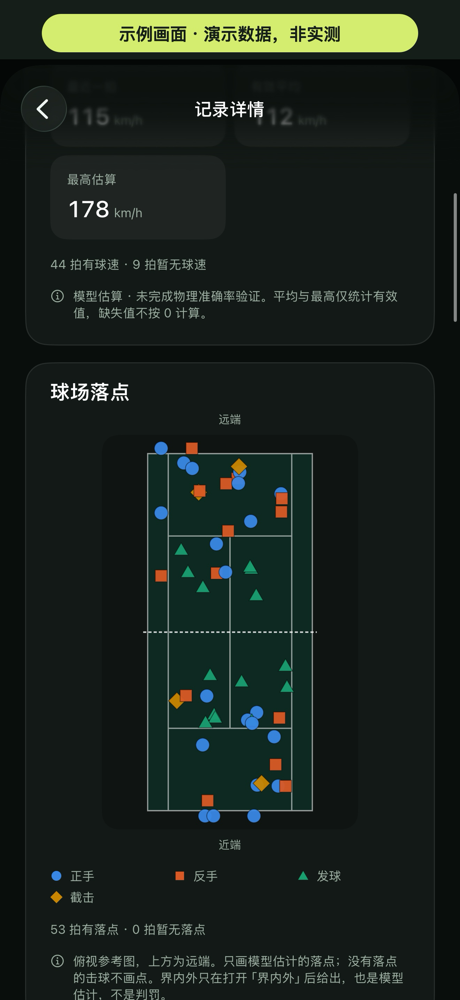</td>
    <td width="33%">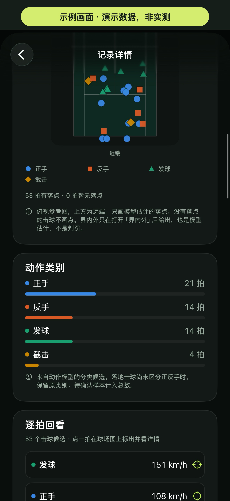</td>
  </tr>
  <tr>
    <td align="center"><sub>球速：每拍的估计值和趋势</sub></td>
    <td align="center"><sub>落点：俯视球场上的触地估计</sub></td>
    <td align="center"><sub>动作：正手、反手、发球……</sub></td>
  </tr>
</table>

<sub>以上三张是示例画面，数据是 `court-probe demo-session` 编造的演示数据，不是实测。</sub>

<p align="center">
  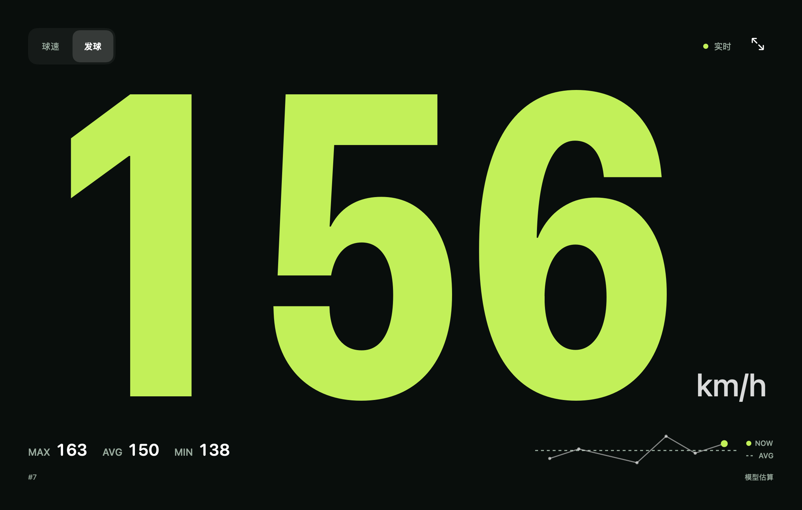
  <br/><sub>场边测速牌（发球模式），数据是虚构示例。</sub>
</p>

<p align="center">
  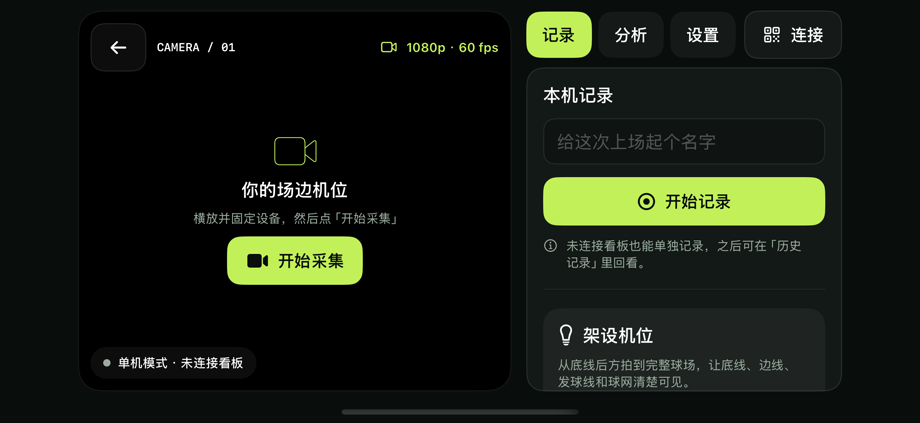
  <br/><sub>机位：横放后自动开始采集，没有看板也能单独记录。</sub>
</p>

## 工作原理

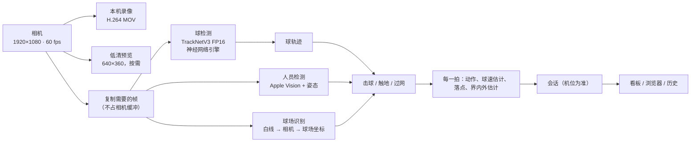

- **采集不等分析**：采集回调里只做常数时间的工作。分析跟不上时丢掉积压、重置轨迹，不会拖慢录像，也不会把断开的轨迹硬拼在一起。
- **发热或分析跟不上时降载**：只削减预览、人员检测和分析频率，从不降低录像的帧率和分辨率；机位页写明原因是发热还是分析落后。
- **球速怎么算**：在识别出的球场坐标里，用带空气阻力的飞行模型拟合击球到触地的球点。看不到落地、点太少或拟合不过检查时不给球速。
- 更多细节：[机位端分析](docs/camera-side-analysis.md)、[界内外](docs/hawk-eye.md)、[模型替换设计](docs/model-replacement-design.md)。

## 效果对比

自研分析链以 **S家**（一款商用网球分析 App）为参照来迭代。S家本身不是真值，和它接近只说明两个软件结论相近，不说明谁更准。下面的数字都只来自对照 S家 App 导出的逐拍结果，用仓库里的 `compare_rows.py` 和 `serve_score.py` 打分。

**发球**（规则 v26，2026-11-03）：

| 视频 | 用途 | 发球识别（F1） | 有球速的发球 | 球速与 S家相差 20% 以内 |
| --- | --- | ---: | ---: | ---: |
| 开发视频 A：高机位单打 | 调参 | 0.94 | 29 / 32 | 26 / 29 |
| 开发视频 B：1.5 米低机位双打 | 调参 | 0.93 | 33 / 37 | 28 / 33 |
| 留出视频：新球场 | 只用来检验 | 0.87 | 44 / 55 | — |

夜场（规则 v35，2026-11-12；同一片夜场同一机位的两段，都用来调过规则，没有留出视频；数字来自 Mac 上「等分析跟上再送帧」的 v29 整段运行，v30 以后只改了规则，是同一份运行记录按新规则重放的。按真实采集节奏时分析会间歇落后，一部分姿态读不到，收益会少一些，少多少没有量）：

| 视频 | 发球识别（F1） | 有球速的发球 | 球速与 S家相差 20% 以内 | 近端界内外判出 | 判出的与 S家一致 |
| --- | ---: | ---: | ---: | ---: | ---: |
| 夜场 A（27 分钟） | 0.71 → 0.91 | 62 / 76 | 58 / 62 | 75 → 103 / 151 | 93 / 103 |
| 夜场 B（42 分钟） | 0.68 → 0.89 | 100 / 119 | 88 / 100 | 129 → 158 / 191 | 139 / 158 |

- v27 让近端发球看球员的姿态（手臂举过头顶），球点改用亚像素位置，并修了发球规则里几处把二发、下网发球漏掉的逻辑；v28 让姿态认出的发球一定出行，并把对拉中的随挥排除；v29 每秒 10 次在两端球员周围读姿态，远端发球也看举臂，发球的击球时刻取手腕最高点、有落点时直接算球速；v30 让球在网后跟丢的发球也能拿到球速（配对过网的那段飞行，网那边再跟上的一小段带着落点也能用）；v31 让落地后只看到几帧的球也能判触地；v32 修了抛球粘在发球前面时的击球时刻（远端发球不再早半秒），近端也看「手臂都放下」来否决假发球，网前滚动的球和隔壁场地的球不再当成对拉，远端下网发球改用球停在网上的那一刻测速，近端发球在远端半场的落点在没有交汇点时也能找到；v33 让落地后只剩一两点还在来球轨迹里、或落地前一两帧才跟丢的球也有近端落点（不确定度至少 1 米，离线 2 米以内写「压线附近」）；v34 在击球点拟合发散（落到场外几十米）时，不再拿它到落点的连线当球速来算落点的不确定度，三个离线大半米的发球不再被写成「压线附近」；v35 让一路跟到落地、落地那一下才跟丢的来球用最后看到的那一点当落点（这时拟合还偏高半米以内，不再拿拟合往后推出来的落点），两段多判出 6、7 拍，没有判反。箭头左边是改之前。
- 按参照里所有该做到的拍算（没判出、没给球速都算没做到）：发球球速在 20% 以内 76% / 74%，近端界内外与参照一致 62% / 73%。目标是三项都到 90% 以上：发球识别接近了（B 段前半有 7 处是参照标错的：触地记成击球、远端二发记成高压，按参照打分的上限约 0.94），发球球速和近端界内外差距主要在覆盖（没有落点就没有球速和判罚）。
- 夜间仍是短板：近端半场仍有两到三成多的拍找不到落点，出界球大多因此没有判罚；远端发球和发球球速的击球时刻还不稳。
- 开发视频 B 上，逐帧看球拍碰球，S家有两拍发球把击球时刻标晚了 0.2–0.3 秒，那两拍它报的球速偏快，所以这段视频上「20% 以内」的上限约为 89%。
- 留出视频上，S家 App 链给的不是同一种球速，没有算「20% 以内」。

**整体**（2026-10-29 到 11-03 的多段视频，对照 S家）：

| 方面 | 自研现状 | 主要差距 |
| --- | --- | --- |
| 击球检出 | 约 2/3 的 S家击球能检出 | 同一次飞行被拆成几段，自研行数是 S家的 2.4–3.1 倍 |
| 动作类别 | 两边都给了类别时约 60% 一致；近端击球点清楚时 20/25 | 广角机位上远端球员只有约 55 px 高，正反手接近抛硬币 |
| 球速覆盖 | 对拉球约 1/5 的 S家有速拍也有球速；发球 80–90% | 触地召回约 40%，看不到落地就不给球速 |
| 界内外 | 判出来的和 S家一致率高（近端 44/45，远端 18/20） | 只判了 S家约一半的拍，缺的是没找到落点 |
| 新球场 | 能自动识别球场 | 换球场后比调参的视频明显变差 |

> [!IMPORTANT]
> 这些数字都不是精度。球速、落点、动作和界内外的真实误差，要在球场上用独立参考来测，目前还没测。不能把它们当雷达测速或正式判罚。

## 路线图

### 上架
- [x] 1.0（iPhone）用自研模型构建并过审（2026-11-03）
- [x] 1.1 的新图标、带大字说明的截图、四种语言（简体、繁体、美式和英式英文）的商店文字
- [x] 改成免费（2026-11-04）：测速、界内外、录像等基本功能全部免费，1.0 已在 175 个地区可下载；以后再规划收费的视频剪辑订阅
- [x] 1.1 (2) 提交审核，并发到 TestFlight 内测和公测（2026-11-04）
- [ ] 1.1 过审上线
- [ ] 真机截图：机位对着真实球场、看板、测速牌；给审核员的演示视频

### 核心功能（优先）

App 的核心是三项：**发球识别与发球球速**（两端）、**近端界内外**（发球和对拉）、**录像与导出**。研究和打磨只围绕这三项。

- [ ] **近端界内外覆盖**：S家判了的近端球，夜场我们判出约七到八成（v35），判出的和 S家一致的约九成，缺的几乎都是没找到落点；先提高触地召回
- [ ] **球检测**：用自动产生的标签（物理拟合的伪标签、离线老师、背景中位图负例）微调 TrackNetV3，提高触地召回和远端发球的小球。2026-11-12 先量了上限：把老师挑出的弱候选当成模型已经认得出，夜场近端界内外在检验的半段只多 3–4 拍，所以暂停
- [ ] **下网发球**：到网时刻用量到的球停时刻约束；低机位近端发球偏快
- [ ] **没有落点的发球**：近端发球的球在网前就跟丢时没有球速（v30 用网那边再跟上的轨迹片段、v32 用短后段和轨迹内最低点补回了一部分）；下网发球的触网时刻（v32 远端改用球停在网上的那一刻，近端还没做）
- [x] **近端发球看姿态**：夜间球离拍后的拖影检不到，改用球员举臂识别近端发球（v27，2026-11-11）
- [x] **发球击球时刻用姿态定**：每秒 10 次在球员周围读姿态，手腕最高点就是击球时刻；有落点的发球直接用「击球时刻 + 落点」算球速，远端发球也看举臂（v29，2026-11-11）
- [ ] **独立参考**：不用雷达（2026-11-03 决定、2026-11-05 确认），评估「超越 S家」现在只能靠物理自检、逐帧核对和击球声定时
- [x] **现场诊断包**：机位每秒记下球场识别、温度和负载，记录详情一键导出诊断包，球场实测的问题有据可查（2026-11-05）
- [ ] iPhone 上自研实时链的长时间发热实测（3 分钟负载测量已通过：分析占用约 73%，温度正常；还缺 30 分钟以上和球场上的实测）

### 其他功能（保留，不再投入）

对拉的动作类别和球速、远端界内外、多报（同一次飞行拆成几拍）照现状保留，暂不安排改进。

### 以后的亮点

- [ ] **双机位联动**：两台机位手机一起拍同一片球场、结果合在一起，是以后值得迭代的亮点功能（2026-11-05）。方案还没定，现在不排期

### 实机和球场
- [ ] 个人热点互传、不在同一网络时的点对点直连
- [ ] 一小时以上的温升和续航、来电与锁屏
- [ ] 按[球场实测方案](docs/field-test-plan.md)做一次带参考值的实测

### 不做
计分、正式判罚、多机位融合、云端或远程观看。

## 快速开始

**需要**：macOS 14+、完整 Xcode、[XcodeGen](https://github.com/yonaskolb/XcodeGen)、Python 3、Git LFS。在 iPhone 上运行需要 iOS 17+ 和开发签名。

```sh
git lfs install && git lfs pull        # 取得自研球检测模型（TrackNetV3，MIT）

./scripts/build-mac.sh                 # Mac App → build/Zacks Court.app
open 'build/Zacks Court.app'

./scripts/generate-ios.sh              # 生成 iPhone 工程，选自己的 Team 运行 ZacksCourt
open apps/iphone/ZacksCourt.xcodeproj

swift build && swift run court-check && swift test   # 本机检查
```

默认构建只带自研模型，这也是上架版本的构建方式。其他构建方式：

| `COURT_MODEL_SET` | 打包内容 | 说明 |
| --- | --- | --- |
| `independent`（默认） | 自研 | 上架版本 |
| `both` | S家 + 自研，App 内切换 | 内测对照用，需要你自己放在本地的 S家模型 |
| `sjia` | 只有 S家 | 同上 |
| `COURT_CODE_ONLY=1` | 不带模型 | 只检查编译，App 不做分析 |

S家模型不在仓库里，也不会进 Git。有的话放在 `.local/s-models/`（已被忽略），`scripts/prepare-analysis-models.sh` 会逐文件校验后打包。完整的构建、测试和约定见 [AGENTS.md](AGENTS.md)。

## 使用指南

1. **架机位**：场边的 iPhone 选「机位」，允许相机和本地网络权限，横放固定，画面自动打开。按「架设机位」提示让整片球场入画。
2. **连看板**（可选）：点侧栏顶部的「连接」。
   - 浏览器看板：用另一台设备扫机位上的二维码；扫不了就在浏览器输入地址和 6 位配对码。可以同时连多台。
   - App 看板：另一台 iPhone 或 Mac 选「看板」→「连接机位」显示二维码，机位点「扫描看板的二维码」。需要加密、点对点直连或整段录像回传时用这种。
3. **球场识别**：打开机位后约半秒自动识别，不用等手机稳住；挂在围网上轻微摆动、手持晃动时也逐帧识别。识别后一直跟着画面走：手机偏了、晃了（手持、支架松动）就每 0.4 秒跟着修正一次球场位置，记录中每分钟再从头复查一次。手机被碰得太猛、转开太多时丢掉旧球场并马上重新识别，这段时间不判界内外，机位页显示「画面晃动较大，逐帧识别中」。画面不在正中（比如对着屏幕拍、视频被裁过）也能识别。没有手动标定：识别不了时机位页写明原因（例如「近端底线和发球线都要在画面里」），按提示调整机位即可。解出的机位如果在近端底线后 12 米以外（常见原因是底线前的地面图案被当成了球场线），当作没认出来，不会拿一个错的球场去判界内外。三脚架或支架仍是最稳的架法：手持时球场跟踪有零点几秒的滞后，界内外和球速的误差会更大。**画面一直在动时不记击球**：找球要和背景画面比，手机转开后灯、场上的球和线都会被当成在飞的球，所以画面离开背景的视角就重新取背景（约 1.6 秒），一直在动就一直不记，固定后自动恢复。这时机位页顶部和「识别状态 › 击球」都写着「画面在动，暂不记击球」，看板上也能看到；画面停稳约 3 秒后提示消失。
4. **持拍手**：近端、远端默认右手，单打可以逐侧改成左手或未知。
5. **开始记录**：在机位或看板点「开始记录」。记录中可以打「精彩」「待复核」标记，或者在看板上点某一拍的 ▶ 取那一拍前后几秒的片段。
6. **回看**：结束后在「历史记录」里按记录或按球速、落点、动作筛选每一拍，单拍可以分享或存到相册。
7. **反馈问题**：在机位上打开这次记录，点「导出 › 诊断包（不含录像）」，得到一个 zip：记录本身、机位每秒的状态（球场认出来没有、为什么没认出、画面晃不晃、温度和负载）和一页中文摘要，不含画面和配对密钥。存到「文件」或直接发给开发者即可；球场认不出时也先开始记录几十秒，录像能一起说明问题。

**不在球场？** 启动页点「导入视频分析」，从相册或「文件」选一段视频（横屏 16:9、720p 以上、60 帧/秒、3 秒到 10 分钟），App 用机位同一套自研模型逐拍分析，结果作为一条记录存进历史，回看和筛选都一样。视频越长分析越久，期间留在这一页；原视频不复制，记录里的录像是重新编码的一份。镜头像机位那样从场边或底线后方拍下整片球场时，球速和落点最容易估计出来。

> [!TIP]
> 长时间录制给机位接充电宝，开「引导式访问」防止误退出。机位退到后台、来电或手机转向时，会话会暂停。

## 数据与隐私

录像和分析结果只存在设备本机，没有账号、云同步或远程观众。

| 内容 | iPhone | Mac |
| --- | --- | --- |
| 会话、录像、逐拍结果 | App 文稿 › `Zacks Court/Sessions`（「文件」App 里可见） | `~/Movies/Zacks Court/Sessions` |
| 看板取到的单拍片段 | `Zacks Court/Sessions/Clips/会话ID/` | `~/Movies/Zacks Court/Sessions/Clips/会话ID/` |
| 机位采集日志（每秒的球场识别、温度、负载、发球人姿态读了几次、曝光，不含画面，保留 14 天） | `Zacks Court/Sessions/Diagnostics/` | —（Mac 不做机位） |

> [!WARNING]
> 配对二维码和配对链接含本次连接的密钥，不要截图公开。
>
> 浏览器看板没有 TLS：浏览器在局域网地址上拿不到可信证书，只能走明文 HTTP。令牌只在二维码里、用 HMAC 证明，不在网络上传；但同一网络里能抓包的人能看到逐拍数据、预览画面和访问码。需要加密时用 App 看板，或只让自己的设备连机位的个人热点。

## 参照 S家做研究

迭代自研分析时，用 S家当参照，但它的模型、导出数据和研究记录都**只放在各人自己的电脑上**，不进 Git：

| 本地内容 | 位置（已被 `.gitignore` 忽略） |
| --- | --- |
| S家模型（可选，用于 `both` / `sjia` 构建和 `court-analyze`） | `.local/s-models/` |
| 运行 S家模型的那部分代码（同上，`scripts/reference-chain.sh` 接入） | `.local/s-chain/` |
| S家 App 导出的逐拍参照行、你的研究笔记 | `docs/s-reference.local.md` 和 `.local/` 下的任意文件 |

怎么准备这些本地文件见 [docs/s-reference.md](docs/s-reference.md)。没有它们也能开发：在自己的 Mac 上装 S家 App，分析同一段视频并导出逐拍结果，再用 `.claude/skills/inhouse-model-research/scripts/compare_rows.py` 和 `serve_score.py` 给自研输出打分。研究流程、开发视频与留出视频的分法、已经试过的方法，见 [研究 skill](.claude/skills/inhouse-model-research/SKILL.md) 和 [前沿地图](.claude/skills/inhouse-model-research/references/frontier.md)。

## 文档

| 文档 | 内容 |
| --- | --- |
| [AGENTS.md](AGENTS.md) | 开发环境、构建和测试命令、模型准备、代码约定 |
| [docs/unified-app.md](docs/unified-app.md) | 产品范围、角色和分析链路 |
| [docs/camera-side-analysis.md](docs/camera-side-analysis.md) | 机位端实时分析：协议、会话所有权、降载、回传 |
| [docs/web-display.md](docs/web-display.md) | 浏览器看板 |
| [docs/hawk-eye.md](docs/hawk-eye.md) | 界内外估计的规则和误差范围 |
| [docs/model-replacement-design.md](docs/model-replacement-design.md) | 自研替代 S家各部分的方案和进度 |
| [docs/design-system.md](docs/design-system.md) | 界面令牌、组件和文案约定 |
| [docs/verification.md](docs/verification.md) | 每一轮的验证记录 |
| [docs/device-validation.md](docs/device-validation.md)、[docs/field-test-plan.md](docs/field-test-plan.md) | 实机和球场验收 |
| [docs/app-store/](docs/app-store/README.md) | 上架材料 |

## 参与开发

欢迎提 Issue 和 PR。动手前请先读 [AGENTS.md](AGENTS.md)：仓库结构、构建与测试命令、哪些结论需要真机证据，以及改界面时要同步的 UI 测试和文档。提交前在本机跑 `swift build`、`swift run court-check`、`swift test`。

## 许可证

代码以 [MIT 许可证](LICENSE) 开源。第三方组件的许可见 `assets/independent-models/*/LICENSE`（TrackNetV3，MIT）和 `Sources/CourtCore/Notices/`。「Zacks Court」名称和应用图标不在许可范围内。S家模型和数据不属于本仓库，也不随仓库分发。
