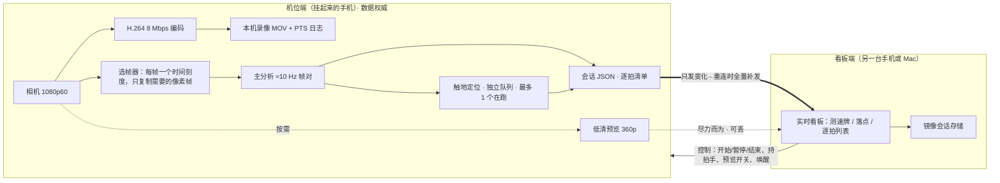

# 机位端实时分析方案（提案）

状态：**Phase 0、1a、1b、2、3 已实现**（Phase 3 于 2026-10-28 完成：单拍片段与点对点直连）。2026-10-27 起草，经 Fable 5.1 顾问模型评审；2026-10-28 完成 Phase 0 算力实测（第 11 节）、值守屏与机位端分析主链路。第 4、5 节已按实际实现改写（重连全量补发代替序号日志）。验证记录见 [verification.md](verification.md)。

## 1. 为什么改

现在的链路是：机位手机采集 1080p60 → 8 Mbps H.264 经 Wi-Fi 发送 → 看板端解码 → 看板端分析。问题在于分析对网络丢帧极其敏感：

- 分析引擎遇到超过 1.8 个源帧（60 fps 时约 30 ms）的时间缺口就重置时序状态和飞行状态。**接收端每一次网络丢帧都会清掉时序上下文**，正在进行的球速拟合与触地判断随之作废。
- 2026-10-26 首轮实机记录：相机报告采集丢帧 0，发送端跳帧计数增加 1,193，即这些帧在机位端已经采到，却在发送闸门（`canAcceptVideo` 为假）处被丢弃；看板端保存的录像中相邻帧有 56 次超过 40 ms 的间隔、最长约 1.62 秒（见 [verification.md](verification.md)）。该记录同时注明，不能把全部缺帧都归因于 Wi-Fi 空口丢包；但可以确定，只要分析在接收端，发送闸门处的每次丢帧都会打断分析。
- 分析放到机位端后，只有采集丢帧会打断时序（首轮为 0），网络好坏只影响看板的显示延迟，不再影响分析结果本身。
- 这些模型能否在手机上与采集、录像同时实时运行，目前本项目没有证据，必须先由 Phase 0 实测确认。
- 传输内容从 8 Mbps 视频变为逐拍数据（估计每秒数 KB，待实测），外加可选的低清预览。热点信号一般时也能保证数据实时到达。

代价和注意事项：

- 机位手机要同时承担采集、编码录像和推理，**算力、发热、电量是这个方案的主要风险**，必须先实测（第 11 节 Phase 0）。
- 机位端分析的是未压缩的原始帧，旧路径分析的是 8 Mbps 解码帧，二者结果不会逐位一致。现有与 S家 输出的对照基线需要重做。

## 2. 新架构



| 职责 | 现在 | 新方案 |
| --- | --- | --- |
| 实时推理 | 看板端 | **机位端** |
| 权威录像 | 看板端（机位只做备份） | **机位端**；看板端在会话后按需拉取 |
| 逐拍结果的权威存储 | 看板端 | **机位端会话 JSON**；看板端保存镜像 |
| 网络上传输 | 1080p60 全量视频 | 逐拍数据 + 状态心跳 + 可选低清预览 |
| 断网影响 | 分析重置、会话 3 秒后自动暂停 | 机位继续录像和分析，重连后补发 |

**连接方向不变**：看板端监听并显示二维码，机位端扫码后主动连接。机位手机有摄像头，扫码最自然；谁监听和谁是数据权威是两回事。

## 3. 机位端流水线

各条通道独立排队，任何分析环节都不能让采集或录像等待：

1. **采集 → 编码 → 录像**：沿用现有 `CameraEngine` 与 `MovieRecorder`，始终 1920×1080 / 60 fps，不因分析或发热降帧。
2. **选帧器**（在采集回调里执行，只做常数时间的工作）：
   - 每一帧都向分析引擎提交一个只含 PTS 的时间刻度，这样「缺口 > 1.8 帧就重置」的规则仍然按真实采集时间判断。
   - 只有引擎真正需要像素的帧才复制。60 fps 时帧对节奏为每 6 帧一组，需要第 6k、6k+1、6k+2 帧（锚帧、相邻帧、配对帧），即每秒复制约 30 帧。
   - 复制进分析自有的、容量固定的 `CVPixelBufferPool`（实现默认 18 个，覆盖主分析持有的锚帧/相邻帧、排队帧和触地定位持有的两帧）。**绝不保留相机自带的缓冲**：`AVCaptureVideoDataOutput` 的缓冲池很小，被占住就会产生采集丢帧，而采集丢帧正是新方案要避免的。
   - 自有缓冲池满了，就跳过这一组，并向引擎标记一次明确的不连续，不跨缺口拼接轨迹。
3. **主分析**（utility 队列）：S家链的球场、帧对特征、时序状态和事件/动作/位置各模型，约 10 Hz；球场分割与球场角点模型的自动映射每 2 秒刷新一次。（S家相关的笔记只保存在本地，见 docs/s-reference.local.md；没有这个文件也不影响开发。）
4. **触地定位**（单独的低优先级队列，最多 1 个任务在跑）：拿到两帧副本后跑 25 个裁块的触地热图搜索，结果按稳定 ID 回填到已发布的击球记录上（现有 upsert 语义已支持晚到的补充）。定位队列忙时，新的触地候选标注「触地定位繁忙，未定位」，落点保持「—」。这样峰值负载不会挤占 10 Hz 主循环。
5. **人员检测**（辅助，1 Hz）：发热时第一个关掉。
6. **低清预览**：只在看板端请求时才编码（见第 4 节）。

2026-10-29起，采集回调另复制每帧的小型 `CaptureFrameMetadata` 观测值：原始CMTime、尺寸、当前样本系统内参附件和可用的连接/设备状态。它随已有编码FrameContext进入实际录像帧的可选header及PTS JSONL，不新增队列或持有相机buffer，缺失K不回填。iOS支持时在开始前启用附件，Mac不调用不可用的控制API；不改变防抖或1080p60设置以取得内参。设备查询值未证明与曝光帧锁定，像素变换/畸变verified始终false，尚不参与测速。Mac上的真实编码/sidecar测试和双平台编译不证明iPhone附件或60fps负载，仍需实机Phase0与几何对应验证；细节见 [独立测速设计](independent-speed-geometry.md)。

分析引擎需要把「时间刻度」和「像素帧」拆成两个入口（或由选帧器驱动同等语义），检测、拟合和门控逻辑不变。`LiveAnalysisPipeline` 已有 `analyzePixelBuffer` 原始帧入口，可在此基础上调整。

Phase 0 优先排查的性能热点是张量拷贝、每帧的 `CIContext` 缩放（可改用 `VTPixelTransferSession` 等硬件缩放或复用中间结果），以及触地定位对同两帧的重复渲染。（S家链的细节只在本地，见 [s-reference.md](s-reference.md)。）

## 4. 数据通道与协议 v2

现有 `PacketDecoder` 只接受 `version == 1` 和 `hello/video/control/status` 四类包，所以升级为协议 v2（2026-10-28 已实现，`Wire.swift`、`WireMessages.swift`）。控制面消息的包体是 JSON；版本不一致时解码器抛出 `CourtError.incompatible`，机位端把它当作终止状态，明确提示「对端运行旧版 Zacks Court（协议 v1）…」，不再重连，也不静默降级。

| 类型 | 方向 | 内容 | 可靠性 |
| --- | --- | --- | --- |
| `hello` | 双向 | 角色、设备名、硬件型号、App 版本、模型版本；**各自未结束的会话**（不含逐拍记录）；可选的 `capabilities`（Phase 3，机位列出 `clips`；界内外版起另列 `hawkEye`） | 连接建立后第一条 |
| `status` | 双向 | 空包体为 1 Hz 传输心跳；机位每秒附带 `CameraStatus`：采集与录像状态、帧率、相机丢帧、本段录像时长、分析状态（是否可用、采集 PTS、最后分析 PTS、标定、模型版本、限制说明）、电量与充电、低电量模式、热状态、相机压力、剩余存储、屏幕模式、降载级别与原因、自检提示、持拍手与手动四角、是否在发预览、最近一次人员检测；当前会话的 ID 与状态（`sessionState`）、机位是否正在封存（`busy`，暂停或结束过程中，变化时立即推送）、界内外设置（`hawkEye`）。后三项可选，旧 v2 机位不带 | 只发最新值 |
| `session` | 机位→看板 | 机位的会话副本（`CourtSession`，不含逐拍记录）；状态、标记、录像列表或人员统计变化时发送，后者最多每秒一次 | 每次重连随握手补发 |
| `analysis` | 机位→看板 | 会话 ID（会话外的最近记录为空）、本次**有变化的**击球记录、标定状态与模型版本；重连时为全量清单（`resync`，每份最多 200 条，带分片序号） | 断线期间不发，重连后全量补齐 |
| `control` | 看板→机位 | `start{会话}`、`pause`、`resume`、`finish`、`marker{标签,时间}`、`handedness`、`preview{开/关}`、`wake`、`transfer`、`clip{流,起止 PTS,文件名}`（Phase 3）、`cancelTransfer`、`hawkEye{开关,单打/双打,远端半场}`（只发给声明了 `hawkEye` 的机位，见 [hawk-eye.md](hawk-eye.md)）；机位对每条回 `reply{ok,原因}`；被取代的机位收到 `superseded` | 机位回执 |
| `preview` | 机位→看板 | 640×360 H.264，平时 15 fps、关键帧间隔 2 秒 | 尽力而为，可丢 |
| `file` | 机位→看板 | 录像分块（Phase 2，每块 1 MB）或单拍片段（Phase 3，`clip-<拍次ID>.mov`，每块 256 KB），带会话 ID、文件名、偏移、总长、SHA-256 | 录像按偏移续传；片段每次重剪、从头发送；都整份校验 |

**优先级**：控制面消息总是立即发送；预览只在连接发送积压小于 64 KB 时发（`CourtConnection.canAcceptPreview`），丢掉的增量帧让编码器在下一帧强制关键帧。一台看板只连一台机位：看板收到新的已认证连接时替换旧连接（Wi-Fi 抖动后旧套接字会残留到 12 秒超时），并向旧连接发 `superseded`；如果那确实是另一台在用同一张票据的机位，它停止重连，避免两台机位互相踢下线。

**只发变化，重连全量**：机位记下每条记录最后一次发出的版本，只发新增或改变的记录（含触地定位队列晚到的落点）。看板用 `CourtSession.mergeRemoteTennisEvents` 按稳定 ID upsert，并采用消息里的标定状态和模型版本。

**最初设想的「wire 日志 + 序号 ack + 从断点补发」没有实现**，改为每次（重）连接时机位把当前会话的完整逐拍清单分片重发一遍：清单就在机位的会话 JSON 里，按 ID upsert 天然幂等，重复和缺号都不需要额外处理；一小时的会话约数千条记录、几 MB，重连时多发这些可以接受。这样少了一份需要和会话 JSON 保持一致的日志文件。

**断线重连**：

- 机位端 `CameraLink` 断线后按 0.5、1、2、4、8 秒退避自动重连，单数次用票据里的地址和端口，双数次按 Bonjour 服务名查找，期间录像和分析照常进行。`Network.framework` 在连接被拒绝时会进入 `.waiting` 并静默等待，`CourtConnection` 把握手前的 `.waiting` 当作失败上报，以便退避和地址/Bonjour 交替真正运行。票据过期、版本不一致或被取代时停止重连并说明原因。
- 看板端重启监听时**沿用同一张配对票据**（距过期不足 10 分钟才换新），并优先复用上次的端口，端口被占时退回任意端口（机位再靠 Bonjour 找到它）。只有手动「刷新配对码」或离开看板角色才生成新密钥。
- **点对点直连（Phase 3）**：看板默认同时在苹果点对点 Wi-Fi（AWDL）上监听，配对票据带 `peerToPeer` 标记，机位据此在 Bonjour 查找中启用点对点。两台设备只要打开 Wi-Fi，不必加入同一网络或热点。票据里的 IPv4 地址仍走局域网或热点；点对点只能靠 Bonjour 找到。点对点链路建立时常先报几秒 `.waiting`，所以 Bonjour 尝试有 3 秒宽限再算失败；上一次连接走的是点对点时，下一轮先用 Bonjour。两端都显示当前连接方式（点对点直连 / 局域网·热点 / 本机回环）。看板可在配对页关闭「允许点对点直连」（密钥不变，机位需重新扫码）；早期版本的票据没有该标记，按关闭处理。点对点会让 Wi-Fi 网卡周期性切换信道，可能略降同网下的吞吐，需要实机对比。

## 5. 会话与存储：所有权翻转

- 机位端由 `CameraSessionController`（CourtCore）持有会话：用自己的 `SessionStore` 保存会话 JSON、MOV 与 PTS 日志，人员检测样本写入 `<会话ID>-analysis.jsonl`。没有看板时，机位端的历史与逐拍回看可以独立使用。
- 看板端保存同一会话 ID 的镜像（会话 JSON 含逐拍记录与录像文件名）；录像在回传前显示「录像保存在机位设备上」，不能在看板上播放。
- **谁开始都可以**：
  - 机位上直接开始（单机模式），或看板在机位连接时开始：看板发 `start{会话}`，机位**采用同一个 ID、标题与已有标记**并开始录像和分析，回发自己的副本；看板收到副本才有这次会话。机位拒绝（正在封存、已有别的会话）时看板不留任何本地会话（2026-10-29 起；此前看板先在本机建会话，被拒后留下一个机位不认可的会话）。
  - 看板在机位未连接时开始：先作为看板本地会话（可以打标记、暂停、继续、结束），机位连上后在握手中采用它。
- **冲突规则：机位优先**。握手时两端各有一个未结束的会话且 ID 不同，机位保留自己的会话（录像和分析在它那里）；看板把本地会话结束并存入历史，切换到机位的会话，并提示「机位已有进行中的会话「…」，看板已切换到该会话；本机会话「…」已结束并保存」。机位上已结束的会话（看板离线期间在机位上点了结束）以机位为准。
- **看板的操作是请求**：机位连接时，看板的开始、暂停、继续、结束、标记一律发给机位执行，机位先回发会话副本再回执，看板只按副本更新。命令在途或机位报告 `busy` 时，看板与浏览器的会话按钮暂停可用并注明「等待机位确认」或「机位正在保存」。机位拒绝或没有回应时，看板保持原状态并显示原因，**不在本地改状态、也不排队**；只有离开看板角色时才在本地收尾。机位不在线时，看板先在本地镜像上生效并排队，重连后按顺序重放；机位上的录像以机位为准，所以排队的「结束」要等机位重连后才会真正停止机位录像。
- **回执反映实际结果**：暂停、继续、结束是幂等的，已处于目标状态算成功（两个看板同时点暂停都成功）；没有对应会话、会话不在记录中时，暂停、继续、结束、标记都回 `ok: false` 并写明原因，不再静默回成功。
- **每秒核对、自动对齐**：看板把 `status` 里的会话 ID 与状态和镜像比较。消息在同一条有序连接上，连续 3 次不一致说明漏了更新：原生看板重发一次 `hello`（只发握手，不重放排队命令），机位照常对账并补发会话与全量清单；浏览器看板经 `/api/session` 重新读取。重试按 5、15、60 秒退避，最多 5 次，仍不一致就提示以机位为准。
- **意外中断的会话**：机位重启后，看板握手带来的未结束会话在机位磁盘上恢复为「意外中断」（不再当作进行中却不录像）。看板与浏览器和机位侧栏一样，为它提供「继续」与「结束」。看板握手也带这种会话，机位再次重启时同样从磁盘恢复；机位从不采用自己没存过的中断会话。
- **离线期间机位结束的会话**：重连时看板还开着的会话若已在机位上结束、机位又开了新会话，机位先把已结束的那份（含录像列表与最终逐拍清单）发给看板，再发新会话；看板镜像因此完整，也不会误报「本机会话已结束并保存」。
- 时长按各自时钟计算：看板创建、机位采用的会话，`elapsed` 包含两台设备的时钟差和消息延迟，误差通常在 1 秒内，不用于击球计时。
- **暂停/继续/结束**：两端都可发起，以机位为准。机位暂停或结束时先封存录像，再让分析器处理完已准入的帧、结束未完成的拍次并等待触地定位队列（`CameraSideAnalyzer.seal`），把尾部结果计入会话，结束时再发一份完整清单。
- **持拍手**：在机位上直接设置，或由看板发往机位执行；机位重新配置分析器（不重新加载模型）并开始新的时序段。
- 机位的相机被系统中断、方向改变、App 退到后台或手动停止采集时，会话**暂停**并写明原因；断流不暂停。看板退到后台时，只有没有机位加入的看板本地会话才暂停。

## 6. 球场标定

- 球场只靠自动识别（2026-11-04 起去掉了手动四角）：自研链用 `IndependentLiveCourt`，S家链用它自己的球场地标映射。识别不了时机位和看板都写明原因，请用户调整机位。
- 旧看板仍可能发 `corners` 或 `still`：这两个命令名和 `still` 包类型保留，只为能解码；机位回执 `ok: false`，说明此版本已去掉手动标定。
- 机位模式打开即自动开始采集（自动横屏后再开相机），回到前台也自动重开；用户点「停止采集」后不再自动打开。重开采集不会继续已暂停的会话。
- 采集方向按手机的物理方向固定（`videoRotationAngleForHorizonLevelCapture` 为 0° 或 180°）。进入机位时手机竖着拿或平放，不报错，相机权限照常立即申请，画面上提示「把手机横过来，画面会自动打开」，手机一横过来就开始采集。采集中手机转向（翻面、拿起、支架松动）时停止采集并按新方向自动重开；有记录在进行就暂停，等用户点「继续」。
- 镜头倍率（2026-10-29，按用户要求与系统相机一致）：采集用多摄虚拟设备，优先 `.builtInTripleCamera`（超广角 0.5×、主摄 1×、长焦 4×），没有 1080p60 时退到 `.builtInDualWideCamera`，再退到单主摄（从 1× 起）。显示倍率 = 设备倍率 × (1 / 第一个切换点)，镜头起点来自 `virtualDeviceSwitchOverVideoZoomFactors`；预设为各镜头与其 2 倍（0.5 / 1 / 2 / 4 / 8），点预设、在预设上拖动（刻度盘，每 90 pt 一倍）或捏合都可无级调节，上限 min(格式最大倍率, 25×)。超过所用镜头 2 倍时界面标橙色（数码放大）。镜头切换行为设为 `.restricted` + `.videoZoomChanged`：只在倍率变化时换镜头，不因对焦或光线自行切换；会话 `active` 时倍率锁定，所以一次录像不会换镜头，帧始终 1920×1080。Phase 0 的负载测量是用单主摄做的，换成虚拟设备后的长时间发热未重新测量。每次改倍率（捏合结束或点预设）调用 `CameraSessionController.framingChanged()`：重启时序分析，自研链丢掉旧球场重新识别，S家链的自动映射在下一次刷新（≤ 2 秒）重新推断。`status.zoom` 为可选字段，只在采集中报告，旧 v2 端忽略。看板端不能远程改倍率。S家 App 的预设为 0.5×–3×，并在录像中拒绝会切换镜头的倍率；这里范围更宽（与系统相机一致），录像中整体锁定倍率。
- 自动映射持续失败或机位被碰动时，两端都显示原因（例如「正在识别球场 · 画面在晃动，尽量拿稳」）；手持晃动时也逐帧跟踪和重新识别，不用等画面稳住。

## 7. 发热与电量：分级降载，不降帧、不降分辨率

输入信号：`AVCaptureDevice.systemPressureState`（仅 iOS）、`ProcessInfo.thermalState`、低电量模式、电池电量与充电状态。Apple 建议在压力升高时降低帧率，但本项目固定 60 fps，所以只削减分析和显示：

| 级别 | 触发 | 动作 | 看板/会话上的显示 |
| --- | --- | --- | --- |
| L0 | 正常 | 全部开启 | — |
| L1 | `fair` 或低电量模式 | 预览降为每秒 1 张静帧；关闭人员检测 | 「机位轻度降载」 |
| L2 | `serious` | 关闭预览；自动映射间隔从 2 秒放宽到 10 秒；暂停触地定位 | 动作与球速照常，落点显示「—：降载期间未定位」 |
| L3 | `critical` | **暂停分析，录像继续** | 会话记录一段「分析暂停：设备过热」区间，该区间的拍次全部为「—」 |
| L4 | `shutdown` | 系统停止相机 | 会话暂停并写明原因，MOV 正常封存 |

- 回升带滞后：压力持续低于当前级别 60 秒后才回升一级。恢复分析时开启新的时序段，不跨暂停区间拟合。
- 离线补算（Phase 2，`OfflineBackfill`）：会话结束后，在保存着录像的设备上（机位，或录像回传后的看板）从历史页对暂停区间的录像跑同一个引擎，先用区间前 2 秒预热时序模型。补算结果标注「离线补算」，只取区间内的拍次，按稳定 ID 合并，不覆盖实时结果。会话不保存手动四角，所以补算用自动球场映射。补算只更新做补算那台设备上的会话副本。
- Mac 做机位时没有 `systemPressureState`，只看 `thermalState`。

## 8. 机位屏幕：值守模式

机位屏幕有三种状态：

```
取景 ──(录像中 + 标定可用 + N 秒无触摸)──▶ 值守 ──(单击)──▶ 唤醒（15 秒）──▶ 值守
  ▲                                                             │
  └────────────────────(暂停 / 结束 / 离开机位)──────────────────┘
```

- **进入值守的条件**：会话录像中，且球场映射可用，且 N 秒无触摸。N 默认 20 秒，可选 10 秒 / 30 秒 / 60 秒 / 从不。录像开始前始终保持取景画面，方便摆机位。
- **值守画面**：
  - **停止渲染相机预览**：把 `AVCaptureVideoPreviewLayer` 的 connection 设为 `isEnabled = false`，或移除预览视图。不能只盖一层黑色遮罩，遮罩下面仍在合成画面、消耗 GPU。
  - 纯黑背景。OLED 屏的黑色像素基本不发光；LCD 机型只能靠降低亮度。
  - 进入时记下当前亮度，用 `UIScreen.brightness`（iOS 27 SDK 中仍可用）降到低值，具体数值实机看户外可读性再定。
  - 只显示几行暗色文字：「REC 23 分」「分析：正常 / 降载 / 暂停」「已连接 / 重连中」「电量 64%」。按分钟刷新，不放动画；每分钟小幅移动文字位置，防止烧屏。
  - 需要人到机位处理的情况（疑似机位移动、存储不足、电量低于 15%、L3 以上过热）自动唤醒一次并显示原因，同时通知看板端。
- **唤醒**：单击任意位置，恢复亮度和预览 15 秒后自动回到值守。单击只负责唤醒，不会触发任何按钮。看板端提供两个按钮：「查看机位画面」把低清预览拉到看板上，机位屏幕保持黑屏；「唤醒机位屏幕」远程点亮机位屏幕，方便人在机位旁调整。
- **防误触**：值守状态下不能直接停止，需要先唤醒，再长按或确认。
- **亮度恢复时机**：场景变为非活跃或进入后台（包括拉下控制中心）、唤醒、暂停或结束会话、离开机位角色。原因是 App 设置的亮度在锁屏前对整台手机都有效。
- **已知限制**：App 在值守状态下崩溃或被强制结束时无法恢复亮度，屏幕会保持低亮度，直到用户锁屏再解锁或手动调节。界面与 README 需要写明这一点。
- **需实机确认**：系统自动亮度是否会在值守期间改写 App 设置的亮度。Phase 0 亮屏运行中，App 设置的 1.0 在 16 分钟内没有被改写；低亮度（值守）下尚未测。
- **不允许自动锁屏**：保持 `isIdleTimerDisabled = true`。锁屏等于进入后台，相机会被系统停掉。建议用户开启「引导式访问」，防止误退出 App。
- **节能效果只能实测**：同一台手机、同样环境，对比「全亮预览」和「值守」各 30 分钟的电量下降与温度，不预设百分比。长时间录制建议外接充电宝。
- **值守模式不依赖分析迁移**：现有架构下机位屏幕同样一直亮着预览，这部分可以先独立上线（Phase 1a）。

## 9. 看板端变化

- `WorkspaceModel` 用「远程分析数据源」替换本地 `LiveAnalysisPipeline`：套用增量记录，在没有会话时自行维护最近记录列表，界面仍合并为每秒最多 4 次刷新。
- 测速牌、落点看板、逐拍列表都只读 `dashboardEvents` / `tennisAnalysis` / `isLive`，界面基本不用改。
- 实时画面窗口改为显示低清预览，并标注「低清 · 有延迟」；只在窗口可见时向机位请求预览。
- 新增机位状态区：电量、温度、降载级别、屏幕模式、分析延迟、补发进度。
- 会话进行中看板只有数据；逐拍视频回看在机位端历史里看，或等录像回传后在看板端看。

## 10. 录像回看与回传

- Phase 1：录像留在机位端，机位端历史支持逐拍回看。
- Phase 2（已实现）：会话结束后在看板历史中「传到本机」，按 `.part` 残留文件的大小续传 MOV，整份 SHA-256 一致后才放进会话目录（文件名与机位相同，会话镜像里已有的 `StoredRecording` 随即可以回放）。逐帧 PTS 日志留在机位。机位记录中拒绝回传，避免实时数据排在大文件后面。8 Mbps 约 60 MB/分钟、3.6 GB/小时；首次实机运行在局域网上约 20 MB/s，建议机位接上电源。
- **Phase 3（已实现）：按拍次取短片段**。看板对某一拍请求「击球前 2 秒到触地（或拍次结束）后 1.5 秒、至少到击球后 3 秒、最长 10 秒」的窗口，按流 ID 与来源 PTS 描述。机位不重新编码，直接拷贝已编码的 8 Mbps 帧：正在录的这一段在内存里保留最近约 30 秒已编码帧（约 30 MB，只是压缩样本，不占相机缓冲；属于这一段录像，停止后仍可读，下一段开始时替换）；更早的拍次从已封存的 MOV 里剪。片段从窗口开始之前最近的关键帧（每秒一个）起，窗口末尾还没采到时机位最多等 4 秒。片段用 256 KB 小块、最多 512 KB 积压发送，记录中也允许发送，实时逐拍数据最多排在一块后面；低清预览在发送期间因积压超过 64 KB 而暂停。一次只发一个文件（录像或片段）。看板保存为 `Clips/<会话ID>/clip-<拍次ID>.mov`，历史、逐拍查询、iPhone 实时面板和 Mac 工作台都可以重看。正在录的这一段里早于内存窗口的拍次，机位明确拒绝并说明「暂停或结束本段录像后可以取片段」。

## 11. 分阶段计划

**Phase 0：实机可行性测量（关口，不改产品行为）**

在 iPhone 17 Pro Max 上用开发构建，同时运行采集、8 Mbps 编码、录像和原始帧分析，连续 30 分钟，记录：

- 主帧对推理耗时 p50/p95；触地定位的峰值耗时；
- 每分钟时序重置次数、自有缓冲池耗尽次数、采集丢帧数；
- `systemPressureState` / `thermalState` 随时间的变化，电量下降；
- 全亮预览与黑屏低亮度两种屏幕状态各跑一次。

通过标准：帧对平均处理时间稳定低于 10 Hz 节奏（100 ms 减去其他负载），积压不增长；分析不引起任何采集丢帧；测试环境下不进入 `critical`。达不到时依次调整：`adapt` 内存拷贝、硬件缩放、计算单元、映射频率、触地定位限流。

同时在 Mac 上做等价性对照：同一段源视频，分别以原始解码帧和 8 Mbps 重编码帧输入 `court-analyze`，比较拍次数、事件 PTS、球速和落点的差异。源文件本身已经是压缩视频，所以这只是近似对照，不等于相机原始帧。

不需要新实机测试的一项：按现有逻辑，看板端开始录像时机位端会同时保存本机备份，且备份写入在发送闸门之前。如果首轮那段机位端备份 MOV 与 PTS 日志还在手机的「Zacks Court/Recordings」目录，检查其相邻帧间隔。若机位端录像没有缺口，就能直接证明「帧在机位端是完整的」。

> 2026-10-28 已完成：手机上仍保留首轮的机位端备份 `Camera-20261026-215027-B33DD5`。其 PTS 日志共 10,635 帧、177.23 秒，按来源 PTS 正好 60.00 fps，最大相邻间隔 16.7 ms，没有超过 1.8 帧的缺口，序号连续，采集丢帧始终为 0；同一段内发送端跳帧计数从 0 增至 1,193。看板端同期保存 9,397 帧，比机位端少 1,238 帧。结论：首轮的缺帧全部发生在机位端之后的传输与接收路径上。

**测量工具**（2026-10-28 已实现）：

- `CourtCore/CameraSideAnalyzer`：第 3 节的选帧器、自有缓冲池（默认 18 个）、主分析队列和独立触地定位队列（自带一份模型运行时，最多 1 个任务在跑）。分析引擎接受无像素的时间刻度帧，并新增 `defersBounceLocalization`；默认行为不变。
- `CameraEngine` 可在没有看板端连接时独立采集和本机录像，并把每帧原始像素交给分析器。
- 开发用测量模式 `Phase0Benchmark` 只在启动环境变量里有 `COURT_PHASE0=1` 时出现，普通启动不受影响。它同时运行 1080p60 采集、8 Mbps 编码、本机录像和机位端分析，每秒记录一行指标。场景里没有真实球场时，用「触地探针」按固定间隔（默认每 1.5 秒）对最近一组帧跑一次完整的触地热图搜索，模拟每拍一次触地定位的负载，结果丢弃。

```sh
xcrun devicectl device process launch --device <UDID> --terminate-existing \
  --environment-variables '{"COURT_PHASE0":"1","COURT_PHASE0_DURATION":"1800","COURT_PHASE0_SCREEN":"bright","COURT_PHASE0_LABEL":"bright30"}' \
  com.claude89757.zackscourt
```

`COURT_PHASE0_SCREEN=dark` 时不挂载预览层、屏幕纯黑；`COURT_PHASE0_BRIGHTNESS` 设亮度（亮屏默认 1.0，黑屏默认 0.1）；`COURT_PHASE0_FOCUS_INTERVAL=0` 关闭探针。结果写入 App 文稿 `Phase0/<时间>-<标签>/`（`meta.json`、`samples.jsonl`、`log.jsonl`、`summary.json`），用 `xcrun devicectl device copy from --domain-type appDataContainer` 取回。录像默认在算完 PTS 连续性后删除，`COURT_PHASE0_KEEP_RECORDING=1` 保留。长按屏幕 2 秒可提前结束；App 离开前台时相机会被系统停掉，本轮随之结束。

**Phase 0 结果（2026-10-28，iPhone 17 Pro Max / iOS 27.0.1，室内常温，未接电源）**

| 关口 | 结果 |
| --- | --- |
| 帧对处理跟得上 10 Hz 节奏、积压不增长 | **通过**（在每 1.5 秒一次触地探针的负载下）。16.2 分钟内帧对 p50 25.0 / p95 39.1 / p99 82.1 ms，分析队列平均占用 27%，最多落后 0.10 s，无时序重置、无缓冲池满、无错配 |
| 分析不引起采集丢帧，录像完整 | **通过**。58,208 帧采集丢帧 0，录像无缺口，码率 8.03 Mbps |
| 测试环境下不进入 critical | **部分**。6.3 分钟升到 fair 后保持，相机压力全程 nominal；只跑了 16 分钟，按用户要求提前结束 |
| 亮屏/黑屏对照、耗电速度 | **未测**。按用户要求跳过黑屏轮；电量读数 5% 一档，16 分钟只跨过一档 |

补充观察：

- p99 约 82 ms 来自每 2 秒一次的球场分割 + 角点模型刷新落在帧对上，仍在 100 ms 节奏内，是压缩余量的主要因素。
- 触地热图定位在手机上约 555 ms/次（Mac 约 228 ms）。放在独立队列后不影响主节奏。场景里没有网球，探针大概率找不到候选，而找到候选后还要渲染两帧、跑两次球场角点模型做映射复核；本轮没有记录探针候选数（已补上该字段），所以 555 ms 只能视为 25 个裁块网格搜索的耗时，真实触地会更慢一些，「每秒约 1.8 次触地」是吞吐上限。
- 内存约 700 MB，其中包含为触地定位队列单独加载的第二份模型；后续可只加载该队列需要的 4 个模型。
- 本轮没有包含：低清预览编码、网络发送、人员检测、由真实击球事件触发的触地定位（用固定间隔探针代替），也只有一台设备、室内环境。

结论：算力可行性已确认，可以进入 Phase 1。长时间（≥ 1 小时）与户外日晒下的发热、耗电，留到 Phase 1a 值守屏完成后，用真实值守画面一并实测。

**Phase 1a：机位值守屏**（2026-10-28 已实现：`CameraStandby`、`CameraStandbyOverlay`）

**Phase 1b：机位端分析主链路**（2026-10-28 已实现）：选帧器与引擎拆分、协议 v2、重连时全量补发（代替 wire 日志/ack）、看板端镜像、会话所有权翻转、按需低清预览、机位端与远程四角标定、实测机型清单与录像前自检。

**Phase 2**（2026-10-28 已实现）：分级降载（`CameraLoadPolicy`）、录像回传（`RecordingTransfer`，每块 1 MB、机位记录中不回传）、离线补算（`OfflineBackfill`）。实机只验证了一次 90 秒的室内运行，见 [verification.md](verification.md)。

**Phase 3**（2026-10-28 已实现）：按拍次取短片段（`ClipExport`、`CameraMediaPipeline.liveClip`、看板 `fetchClip`）、点对点直连（`PairingTicket.peerToPeer`、`CourtConnection.waitingGrace`、`LinkPath`）。点对点只在单机回环和同一局域网下验证了不影响原有链路；两台设备不在同一网络时的直连需要实机验收，见 [实机验收清单](device-validation.md)。

## 12. 验收

- `swift test`：协议 v2 编解码与上限、版本不一致时明确拒绝；日志补发在重复和缺号时的幂等性；增量 upsert 与全量清单结果一致；会话中断线重连不丢拍次；选帧器不持有相机缓冲、缓冲池耗尽时产生明确重置。
- `court-probe` 回环：限速网络下数据延迟保持有界，只有预览降级。
- 实机：30 分钟发热与电量（值守开/关）；会话中断开并恢复 Wi-Fi；会话中看板 App 退后台再回来；碰动机位后的提醒。
- 证据口径不变：合成视频、模拟器和回环测试只证明软件流程，不证明测速、落点或分类精度。

## 13. 已定事项（2026-10-28 用户确认）

1. **只支持实测通过的机位机型**（2026-10-29 起改为：iPhone 13 及更新机型都可做机位，见下文末尾）。接收端实时分析（视频传到看板端再分析）在 Phase 1b 完成后从产品中移除，只保留机位端一条链路；`court-analyze` 离线分析不受影响。机位端维护一份实测机型清单，目前只有 iPhone 17 Pro Max（iPhone18,2）；不在清单内的设备进入机位角色时明确提示「该机型尚未实测，不能作为机位」。清单内的设备开始录像前再做一次短时自检（模型加载、几秒实时帧对耗时、热状态、低电量模式），用来发现当次异常，而不是放行未测机型。Mac 做机位同样需要实测登记。新增机型时用第 11 节的测量模式实测一台再加入清单。
   - 2026-10-29 用户要求支持 iPhone 13 以后的机型：`CameraHardware.isSupported` 放行型号代号 iPhone14,x 及以上（A15 及更新芯片，全部支持 1080p60），以后的新机型不改代码即可使用；`CameraHardware.measured` 仍只有 iPhone18,2。未实测机型进入机位不再被拒，而是在机位页提示「还没做过负载实测」，发热与分析落后照常由降载与时序重置处理。镜头按机型自动选择：Pro 三摄（13/14 Pro 为 3× 长焦、15 Pro Max/16 Pro 为 5×、17 Pro 为 4×）、标准版双摄、SE 第 3 代/16e/Air 单摄（从 1× 起）。各机型的发热、续航与实时分析是否跟得上都未实测。
2. **会话进行中看板端只看数据**。会话中只有实时逐拍数据和按需低清画面，不提供逐拍视频片段；逐拍视频回看在机位端历史里进行，或在录像回传后在看板端进行。按拍次取短片段已在 Phase 3 实现（第 10 节）。
3. **支持单机模式**。没有看板端时，机位手机可以自己开始、暂停、结束会话，结束后在机位端回看，或回传到 Mac。因此 Phase 1b 的机位端界面需要会话控制（开始/暂停/结束）、逐拍列表与历史回看；看板端连上后采用机位端的会话 ID 并补齐数据。
4. **录像回传手动触发**。会话结束后在历史中点「传到本机」，支持断点续传，充电时提示；不自动传输数 GB 文件。

默认值（用户未另行指定）：值守等待 20 秒（可选 10 / 30 / 60 秒 / 从不）；同一时间只连接一台看板端。
