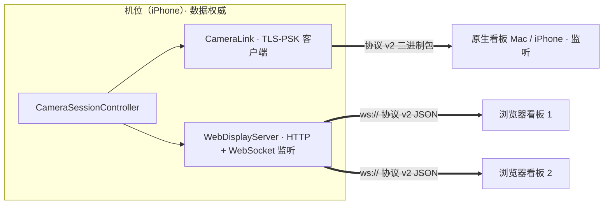

# 浏览器看板方案

状态：**W1–W3 已实现**（2026-10-28）。2026-10-28 起草，经 Fable 5.1 顾问模型评审；四项关键取舍由用户确认（第 2 节）。实现后用户补充要求的全屏测速牌与逐拍分页也已加入（第 9 节）。软件流程只在本机回环与 Mac 模拟机位上验证过，安卓、平板、热点和球场都**未实测**（第 11 节）。

## 1. 目标与边界

原生看板只能是 Mac 或 iPhone。浏览器看板让安卓手机、安卓/iPad 平板或任何电脑，在**同一 Wi-Fi 或机位手机的个人热点**里，扫机位屏幕上的二维码（或手动输入局域网地址和 6 位配对码）后，在浏览器里得到看板的主要功能：

| 功能 | 浏览器看板 | 说明 |
| --- | --- | --- |
| 实时逐拍数据（测速牌、落点、逐拍列表）、机位状态 | 有 | 与原生看板同一份协议 v2 JSON |
| 开始 / 暂停 / 继续 / 结束、标记、持拍手、唤醒机位屏幕 | 有 | 都是请求，机位执行并回执 |
| 低清实时画面 | 有 | 640×360 JPEG，最多 5 帧/秒（第 6 节） |
| 远程四角标定 | 有 | 机位发一张全分辨率静帧，在浏览器上点四角 |
| 历史与逐拍回看 | 有 | 直接读机位上的会话，浏览器不存镜像 |
| 单拍片段播放与下载 | 有 | 机位剪出 `.mp4`，浏览器 `<video>` 播放，之后显示「下载这一拍」（同一地址，`download` 文件名如 `ZacksCourt-第3拍-反手-120kmh.mp4`；机位缓存剪好的文件，不会再剪一次） |
| 存储清理 | 无 | 只能在机位或 App 看板上清理；`/api/session` 返回 `available`（机位上还在的录像），已清理的录像不再显示下载链接 |
| 整段录像下载 | 有 | 会话结束后下载 MOV，记录中拒绝 |
| 离线补算 | 无 | 在机位或原生看板上做 |
| 点对点直连（AWDL） | 无 | 安卓没有；只支持同一局域网或热点 |
| 看板镜像存储、断网后离线查看 | 无 | 浏览器是瘦客户端，机位是唯一数据源 |
| Mac 辅助窗口（测速牌窗口、落点窗口） | 无 | 浏览器可全屏，或多开标签页 |

不变的事：机位仍是会话、录像和逐拍结果的唯一权威；原生看板链路（TLS-PSK、看板监听、机位扫码连接）不改；浏览器看板与原生看板可以同时连接同一台机位。

## 2. 已定取舍（2026-10-28 用户确认）

1. **明文 HTTP + 一次性令牌**，不用自签名 HTTPS。代价写在第 4 节。
2. **允许多个浏览器同时连接，每个都能控制**。机位本来就是权威，每条命令有回执、冲突以机位为准。这打破了「同一时间只连一台看板」的旧默认，但只对浏览器看板放开；原生看板仍是一台。
3. **预览用 JPEG 帧，最多 5 帧/秒**，不做浏览器端 H.264。
4. **四项扩展都做**：远程四角标定、历史与逐拍回看、单拍片段播放、整段录像下载。

## 3. 架构：连接方向反过来

原生看板是「看板监听、机位连过去」（[camera-side-analysis.md](camera-side-analysis.md) 第 4 节）。浏览器既不能监听端口，也说不了 TLS-PSK，所以**浏览器看板是这条规则的例外**：机位在本机起一个 HTTP + WebSocket 服务，浏览器连机位。两条链路互不依赖，可以同时存在。

- **服务端** `CourtCore/WebDisplayServer`：`NWListener`（TCP，固定优先端口 8787，被占时取任意端口）上手写最小 HTTP/1.1 与 RFC 6455 WebSocket：静态文件、`/ws`、`/api/*`、视频 `Range` 请求。不引入第三方库（`Package.swift` 目前没有任何外部依赖）。不发 Bonjour：安卓浏览器不能解析，靠二维码里的 IP。
- **静态页面** 放在 `Sources/CourtCore/Web/`（SwiftPM 资源，iOS 工程经包依赖自动带上；`build-mac.sh` 把资源包拷进 Mac App）。不用 `Bundle.module`（找不到资源包时直接崩溃），自写查找：候选路径都没有时，开关旁明确显示「浏览器看板资源缺失」。无构建步骤的原生 ES 模块 + CSS，CI 不需要 Node。
- **机位端泛化**：`CameraSessionController` 原来只有一个 `link`；现在每条发往看板的消息同时交给 `CameraLink` 与 `WebDisplayServer`（广播），浏览器发来的控制命令走与原生看板完全相同的 `apply(control)`。新浏览器连上时只给它补发会话、全量逐拍清单、会话外最近记录和当前状态。
- **地址**：二维码只能编码一个地址，取 `LocalNetwork.ipv4Addresses()` 的第一个；有多个时其余地址以文字列出。iPhone 自己开个人热点时监听地址落在哪个接口、能否取到，**待实机确认**。
- **默认开启，是主推的连接方式**（2026-10-29 起，原为默认关闭）：进入机位角色即监听。机位侧栏顶部固定一个「连接」按钮，点开是全屏连接页，先问「另一台设备装了 Zacks Court 吗？」（默认「没装 · 用浏览器」，已和 App 看板配对过时默认另一项）：浏览器一侧是二维码、连接状态、地址与配对码、「刷新配对」（先确认）、「允许浏览器连接」开关；App 看板一侧是机位扫看板二维码或粘贴链接、「重新连接」与「断开」（先确认）。两个方向的码不会同时出现。关掉开关后停止监听并记住选择；离开机位角色时停止。默认开启意味着进入机位角色就会生成并在钥匙串里保存浏览器凭据，包括开发用的 Autopilot 与 Phase 0 运行。

## 4. 认证与安全

**威胁模型**：同一 Wi-Fi 或热点里的其他设备。浏览器在 `http://192.168.x.x` 这类地址下不是安全上下文（第 8 节实测），拿不到 `crypto.subtle`，也无法建立可信 TLS。

- **令牌**：开启浏览器看板时机位生成 32 字节随机令牌，有效期 12 小时，保存在钥匙串（App 被系统结束后重开不变，浏览器可自动重连；不进 UserDefaults）。「刷新配对」立即作废旧令牌并断开所有浏览器；关闭开关或离开机位角色也作废令牌。App 回到前台时若监听已被系统收回，会用同一令牌重新监听。
- **二维码**：`http://<机位IP>:<端口>/#t=<令牌>`。令牌在 `#` 后面，浏览器不会把它发给服务器，也不进任何访问日志；页面读出后立即用 `history.replaceState` 从地址栏去掉，存进本标签页的 `sessionStorage` 与 `localStorage`（用于重连）。
- **WebSocket 挑战应答**：连上 `/ws` 后服务器先发一次性随机数，浏览器回 `HMAC-SHA256(令牌, 随机数)`（纯 JS 实现的 SHA-256，因为没有 `crypto.subtle`）。令牌本身从不在网络上传输。认证前只接受这一条消息，5 秒内不完成就断开。
- **手动输入地址**：用户输入 `http://<IP>:<端口>`，页面没有令牌时显示 6 位数字配对码输入框；机位屏幕显示该码。配对码正确时服务器在 WebSocket 里回发令牌，之后与扫码相同。连续 5 次错误立即换码（机位屏幕刷新），防在线穷举。
- **HTTP 接口**（历史、片段、录像、静帧）：浏览器的 `<video>` 和下载链接不能带自定义请求头，所以 WebSocket 认证后服务器发一个**本连接专用的访问码**，HTTP 请求带 `?k=<访问码>`；该 WebSocket 断开 60 秒后访问码失效。静态页面本身不需要认证。
- **有意降级（写进 README）**：明文 HTTP 下，同一网络里能抓包的人可以看到逐拍数据、预览画面和访问码，并在访问码有效期内冒用它；用配对码登录时令牌也以明文回发。这比原生看板的 TLS-PSK 弱。浏览器看板只防「同一网络里没看到机位屏幕的人」，不防抓包。需要更强保护时用原生看板或机位开的个人热点。
- 令牌、配对码、访问码不写日志、截图或提交；服务器不记录请求 URL。

## 5. WebSocket 协议：复用 v2 JSON

WebSocket 文本帧是一个 JSON 信封：`{"kind": "<WireKind>", "body": <原 v2 包体>}`，`kind` 与 `body` 的含义和 [camera-side-analysis.md](camera-side-analysis.md) 第 4 节完全相同（`hello`、`status`、`session`、`analysis`、`control`）。唯一的编码差别：**日期一律为 1970 年起的毫秒数**（`new Date(n)` 直接可用），原生链路仍用 Foundation 默认编码，两者互不影响。第二个差别：逐拍记录（`analysis`、`session`、`/api/session` 里的 `TennisShotEvent`）多带两个只读字段 `speedReasonText`、`placementReasonText`，即 App 显示的「没看清球」「球速不可靠，未计入」「还在分析」等短句（`TennisReason.text`）；有球速或有落点时不带对应字段。原生链路和保存的会话不带这两个字段，只带可选的 `speedReasonCode` / `bounce.reasonCode`，旧版 v2 对端照常解码。另加只用于浏览器的几种：

| kind | 方向 | 内容 |
| --- | --- | --- |
| `auth` | 双向 | 服务器：`{nonce, version}`；浏览器：`{mac}` 或 `{pin}`；服务器：`{ok, token?, access?, message?}` |
| `preview` | 浏览器→机位 | `{enabled}`，代替原生的 `control.preview` 只管本连接 |
| `still` / `frame` | 机位→浏览器 | 二进制帧：1 字节类型（1=预览 JPEG，2=标定静帧）+ 4 字节 JSON 长度 + JSON（宽高、流 ID、请求 ID）+ JPEG |

- 协议版本仍是 v2：服务器 `auth` 里带 `version: 2`，浏览器不匹配时显示「请刷新页面」。
- 浏览器 `hello` 声明 `role: display`、`capabilities: ["web"]`，不带会话（浏览器从不持有自己的会话）。服务器只给这一个连接补发会话、全量逐拍清单、会话外最近记录与当前状态。
- **开始记录**：浏览器发 `control.start`，只带 `label`（标题），不带 `session`；机位用自己的 `startSession` 创建会话后回发。浏览器离线时按钮不可用——浏览器没有本地会话，不排队。
- **控制命令 ID**：`WireControl.id` 必填。`crypto.randomUUID()` 在非安全上下文不可用，浏览器用 `crypto.getRandomValues` 拼 v4 UUID。
- **会话状态以机位为准**：机位的 `hello` 带它未结束的会话（没有则不带该字段），页面据此替换自己显示的会话，所以重连到重启过的机位不会残留「进行中」。`status` 每秒带 `sessionState` 与 `busy`：会话命令在途或机位正在封存时，开始、暂停/继续、结束、标记按钮暂停可用并显示原因；连续 3 次与页面显示的会话不一致时，页面经 `/api/session` 重新读取（5、15、60 秒退避，最多 5 次）。意外中断的会话显示「继续」与「结束」。这部分页面逻辑没有自动化测试，见 [verification.md](verification.md) 的手动记录。
- **回执按发起者路由**：服务器记住「命令 ID → 客户端」，`reply` 与标定静帧只发给发起它的那个浏览器；原生看板收不到浏览器请求的回执，反之亦然。回执的 `ok` 按命令执行后的实际状态判断（例如两个浏览器同时点暂停，第二个收到「会话已暂停」而不是静默成功）。
- **每连接积压上限**：与 `CourtConnection` 同一规则，某个浏览器的发送积压超过 8 MB 就断开它，它重连后拿到全量补发；慢平板不会吃光机位内存，也不影响其他看板。
- **一致性**：重连时机位全量补发，与原生看板同一套逻辑；浏览器按稳定 ID upsert。
- **界内外**：机位 `hello.capabilities` 含 `hawkEye` 时页面显示「界内外」按钮（状态栏与测速牌），开启时先选单打或双打，经 `control.hawkEye` 发给机位，以 `status.hawkEye` 的回显为准。判定在机位上做，随逐拍行的 `bounce.hawkEye` 到达；页面对每拍只提醒一次，补发（`resync`）里的旧拍不提醒。出界时用 `speechSynthesis` 说「Out!」：浏览器要求先点一下页面，开启界内外的那一下会顺便解锁，刷新后显示「点此开启 Out! 语音」。语音开关存在本浏览器。全屏测速牌上有「界内外回放」：在 canvas 上按和 App 相同的几何回放判过的拍（`app.js` 里的 `replayScene` 对应 `HawkEyeReplay.swift`），下面用 `/api/clip` 播放这一拍的视频；回放打开时新的判定卡片不遮挡它，语音照常。规则见 [hawk-eye.md](hawk-eye.md)。

## 6. 低清预览：JPEG

- 来源是**分析器已复制的最新帧**（`CameraSideAnalyzer` 自有缓冲池里的那一帧），不碰相机缓冲，也不新增采集回调里的工作。
- 独立的 utility 队列缩放到 640×360 并编 JPEG（质量 0.6），**最多 1 帧在途**；在途时到点的帧直接跳过。
- 节奏：L0 最多 5 帧/秒，L1 每秒 1 帧（与原生预览同一降载规则），L2 及以上停发。只在至少一个浏览器打开了画面时运行。
- 每个浏览器连接单独限流：该连接发送积压 ≥ 64 KB 时跳过这一帧（与原生 `canAcceptPreview` 同一阈值），所以慢的浏览器不会拖慢别的浏览器，也不会让数据排在画面后面。
- 分析暂停（L3）时最新帧不再更新，浏览器显示「画面暂停：机位降载」。
- 这一条通道在机位上的发热与耗电**未测**，W2 完成后用 Phase 0 测量模式加一个浏览器预览负载跑一次短测。

## 7. HTTP 接口

全部需要 `?k=<访问码>`，只读，`GET`：

| 路径 | 返回 |
| --- | --- |
| `/api/sessions` | 机位上全部会话的摘要（不含逐拍记录）：ID、标题、状态、开始时间、时长、拍数、录像列表 |
| `/api/session?id=` | 一个会话的完整 JSON（含逐拍记录、标定、模型版本、分析暂停区间） |
| `/api/clip?session=&shot=` | 某一拍的片段，`video/mp4`，支持 `Range` |
| `/api/recording?session=&file=` | 整段录像，`video/quicktime`，`Content-Disposition: attachment`，支持 `Range` 续传 |

- **片段**：窗口与原生看板相同（击球前 2 秒到触地后 1.5 秒、至少到击球后 3 秒、最长 10 秒），机位不重新编码，复用 `ClipExport` 但容器改为 `.mp4`（实测浏览器对 `.mov` 的 `canPlayType` 为空，`.mp4` 为 probably）。剪好的文件缓存在临时目录，同一拍再次请求直接复用；正在录的这一段里早于内存 30 秒窗口的拍次，返回与原生相同的拒绝原因。
- **录像下载**：会话记录中返回 409「机位正在记录，暂停或结束后再下载」；同一时间只允许一个录像下载（与原生回传共用「一次只发一个文件」的锁，片段除外）。
- **数据优先于文件**：HTTP 文件响应按 256 KB 分块、每连接积压不超过 512 KB 发送；WebSocket 是另一条 TCP 连接，两者在空口上的先后由 Wi-Fi 决定，无法像单连接那样严格排序。片段约 10 MB，影响有限；整段录像只在不记录时允许。

## 8. 浏览器限制（2026-10-28 实测）

在 `http://192.168.31.38:8765/`（本机局域网地址、非 localhost）用应用内置浏览器（Chromium 内核）打开探测页：

| 能力 | 结果 | 影响 |
| --- | --- | --- |
| `isSecureContext` | false | 下列安全上下文专属能力都不可用 |
| WebCodecs `VideoDecoder` | 无 | 不能硬解 H.264，预览改用 JPEG |
| `crypto.subtle` | 无 | HMAC 用纯 JS 实现 |
| Screen Wake Lock | 只在安全上下文里有 | 明文 HTTP 下浏览器一般不提供：打开测速牌时先检测 `navigator.wakeLock`，可用才申请；不可用时测速牌底部提示「请在系统设置里关闭自动锁屏」，不做静音视频之类的变通 |
| Service Worker | 无 | 不做离线缓存 |
| `crypto.randomUUID` | 无（安全上下文专属，未单独探测，按规范） | 用 `getRandomValues` 拼 UUID |
| WebSocket、Fullscreen、IndexedDB、MSE | 有 | |
| `<video>` `.mov`（H.264） | 空 | 片段用 `.mp4` |
| `<video>` `.mp4`（H.264） | probably | |

这只是桌面 Chromium 的结果；安卓 Chrome、iPad Safari、三星浏览器要实机确认（第 11 节）。

## 9. 页面

- 单页应用，竖屏单列、横屏/宽屏双栏；最小宽度 320 px。颜色、圆角、状态语气镜像 `CourtStyle` 令牌为 CSS 变量（[design-system.md](design-system.md)）；App 只有深色外观，页面同样只做深色。
- 首屏：连接状态（已连接 / 重连中 / 令牌失效）、机位状态条（录像时长、分析状态、电量、温度、降载级别，倍率不是 1× 时显示镜头倍率），控制按钮（开始 / 暂停 / 继续 / 结束、标记）。
- 主区：球速（最近一拍、有效平均、最高估算）、落点图（球场 SVG + 落点候选）、逐拍列表（每行可播放这一拍的片段）。
- **全屏测速牌**：与原生 `CourtSpeedBoard` 同一规则，只显示最近一拍**有效**球速，本拍没测出时保留上一有效值并注明「本拍暂无球速 · 保留上一有效值」，没有数据时是细的「--」，底部注明「模型估算」。数字按读数区的容器尺寸（`cqw` / `cqh`）铺满，按三位数定字号，宽而矮时单位放到数字旁边。左上角可切到「发球」：当前发球球速同样铺满，下方一行 MAX / AVG / MIN 和一条没有坐标轴的细趋势线（SVG），宽屏并排、竖屏叠放、矮时收起，阈值与原生 `ServeBandLayout` 相同，选择记在本浏览器。支持全屏接口的浏览器（安卓 Chrome、iPad）进入真正全屏；不支持的（iPhone Safari 没有元素全屏）铺满整个页面。
- **逐拍分页**：实时列表与历史详情都先显示最近 30 拍，底部「显示更早的 N 拍（共 M 拍）」逐页加载。一小时可能有上千拍，一次画出全部会让平板卡顿；实时列表在新会话开始时回到第一页，已打开的片段播放器在刷新时保留。`?page=5` 只用来在短会话上检查分页。
- 辅助区：实时画面开关、持拍手（选项顺序与 App 相同：未知、右手、左手，保存后有提示）、标定球场（四角）、唤醒机位屏幕、历史记录（页面连上机位后自动读取一次，之后点「刷新」）。
- 用词与 App 相同：记录状态「进行中 / 已暂停 / 已完成 / 意外中断」，温度「正常 / 偏暖 / 偏高 / 过热」，标记「精彩 / 待复核」。逐拍行的「球速：…」「落点：…」由机位在 JSON 里直接下发（`speedReasonText`、`placementReasonText`，见第 5 节；旧版机位只发引擎原文时页面退回显示原文），页面不另维护文案表；落点显示为「约横 x.x m，纵 y.y m」。
- 颜色：红色只用于 REC；错误、提示条和「结束」按钮用橙色。动作类别的颜色只在色点上，文字用正文色；落点图与图例用和 App 相同的形状（圆、方、三角、菱形、五边形、叉、加号、星形）区分动作，每个落点带读屏说明（第几拍、动作、球速、大致位置），球场颜色与 App 的 `courtSurface` / `courtLine` / `courtNet` 一致。标定对话框里画面按窗口高度放大，按住出现 3 倍放大镜，已放的角可以拖动微调，并写明标定需要目视操作。提示条在全屏测速牌之上（全屏时放进测速牌里）。「恢复自动映射…」单独放在标定对话框底部，点后先确认。区块的英文小标题对读屏隐藏。
- 交互控件至少 44 px；可见文字与 `data-testid="court.*"` 标识沿用原生命名，便于将来写浏览器端自动化。
- **产品不变量照旧**：缺少证据的球速、落点、类别显示「—」并附原因，统计只算有效值；球速、落点始终称为「估计」「候选」；未确认持拍手时只显示「落地击球」；不做计分。
- 断线时页面保留最后的数据并标注「已断开，正在重连」，按 0.5、1、2、4、8 秒退避自动重连；令牌失效时提示重新扫码。

## 10. 分阶段

| 阶段（均已实现） | 内容 | 验收 |
| --- | --- | --- |
| **W1** 数据与控制 | `WebDisplayServer`（HTTP、WebSocket、认证、配对码）、控制器广播与补发、机位页面开关与二维码、浏览器页面的状态、控制、测速牌、落点、逐拍列表 | `swift test`：HTTP/WebSocket 解析、错误令牌与过期拒绝、配对码 5 次错误换码、控制往返与回执、重连全量补发、两个浏览器同时连接；内置浏览器以手机与平板视口打开 Mac 模拟机位 |
| **W2** 画面与标定 | JPEG 预览通道、每连接积压闸门、远程四角标定 | `swift test`：预览只在请求时运行、积压闸门、L1/L2 降载；内置浏览器看到画面并完成一次四角标定 |
| **W3** 历史、片段、录像 | `/api/*`、`.mp4` 片段、录像下载与文件锁 | `swift test`：访问码校验与失效、Range、记录中拒绝下载、片段复用；内置浏览器播放一个片段 |

## 11. 验收与证据口径

- `swift test` 用 `URLSessionWebSocketTask` 和 `URLSession` 在进程内扮演浏览器，不需要新工具。
- 「Mac 做模拟机位」：`court-probe web <视频>` 用本地视频当机位、在这台 Mac 上分析并开启浏览器看板，再用应用内置浏览器以 375×812 与 1024×768 视口打开。**这只证明软件流程**，不证明安卓、平板、热点或球场效果。
- 实机清单（写进 [device-validation.md](device-validation.md)，未跑之前不算通过）：安卓 Chrome 扫码打开、同一 Wi-Fi 与机位个人热点两种拓扑、平板息屏与保持亮屏、片段 `.mp4` 在安卓与 iPad 上播放、录像下载、两台浏览器同时控制、机位开 JPEG 预览后的短时发热。
- 每一轮在 [verification.md](verification.md) 追加带日期的小节；README 与 [unified-app.md](unified-app.md) 同步说明浏览器看板与它的安全降级。

## 12. 实现记录（2026-10-28）

| 部分 | 位置 |
| --- | --- |
| HTTP/1.1 + WebSocket 服务器、认证、访问码、Range | `CourtCore/WebDisplayServer.swift`、`WebDisplay.swift` |
| 控制器广播、按发起者回执、补发、JPEG 预览、`/api/*` | `CameraSessionController`（Browser displays 一节）、`WebDisplayModels.swift`、`CameraSideAnalyzer.latestFrameBuffer` |
| `.mp4` 片段 | `ClipExport.write` 按扩展名选容器 |
| 页面 | `Sources/CourtCore/Web/`（`index.html`、`style.css`、`app.js`、`hmac.js`） |
| 机位开关、二维码、地址与配对码 | `CameraWorkspace`「浏览器看板」面板、`CameraModel` |
| Mac 模拟机位 | `swift run court-probe web [视频]`：二维码地址与配对码写入 `.local/probe-web-*/web-pairing.txt`（0600），不打印；`COURT_WEB_ROOT=Sources/CourtCore/Web` 直接用源码页面，改完刷新即可 |

实现中顺带修了一个已有问题：`SessionStore.recordingURL` 用 URL 相等比较录像所在目录，而目录 URL 末尾是否带 `/` 取决于创建时文件夹是否已存在；目录路径里没有符号链接时（例如 `.local/` 下），每段录像都会被拒为「指向会话目录之外」。原生「传到本机」与浏览器下载都走这个函数。现在比较标准化后的路径，`TennisSessionTests.testRecordingURLAcceptsFolderMadeBeforeItExisted` 覆盖（修复前失败、修复后通过）。iPhone 上的存储目录是否受影响没有单独核实。
